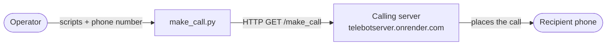

# TeleScript Caller: High-Level Design

A small Python client that asks a calling server to phone a number and play three custom scripts (welcome, cancel and wait). For code-level detail see the [Low-Level Design](lld.md).

## 1. Context

## 2. Components

| Component | Responsibility |
|---|---|
| `make_call.py` | Prompts for inputs, builds the request, reports success or the HTTP status |
| Calling server | External service that performs the phone call (not part of this repo) |

## 3. Tech

| Item | Choice |
|---|---|
| Language | Python 3 |
| HTTP | `requests` |

## 4. Notes

The server URL is fixed in the script. Script text is placed in the query string, so long or special-character scripts should be URL-encoded (passing `params=` to `requests.get` would do this automatically).
