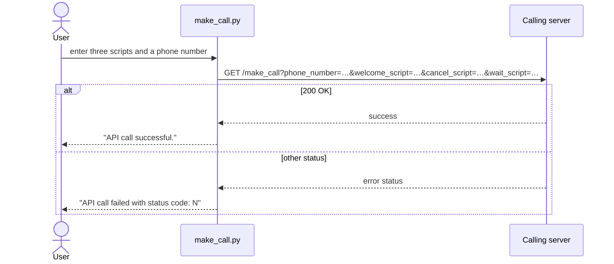

# TeleScript Caller: Low-Level Design

For the big picture see the [High-Level Design](hld.md).

## 1. Functions

| Function | Behavior |
|---|---|
| `main()` | Reads `welcome_script`, `cancel_script`, `wait_script`, `phone_number` from input, calls `make_api_call` |
| `make_api_call(welcome_script, cancel_script, wait_script, phone_number)` | Joins the four values as `key=value` pairs onto `https://telebotserver.onrender.com/make_call?`, sends a GET, prints the outcome |

## 2. Sequence

## 3. Request parameters

| Parameter | Meaning |
|---|---|
| `phone_number` | Number to call |
| `welcome_script` | Played when the call is answered |
| `cancel_script` | Played on cancellation |
| `wait_script` | Played while waiting |
